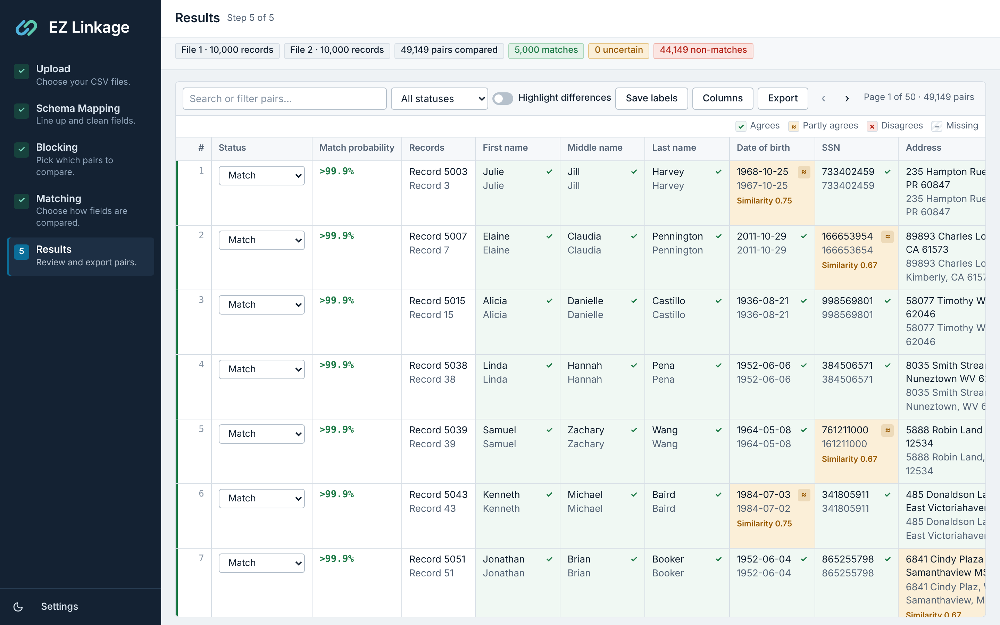
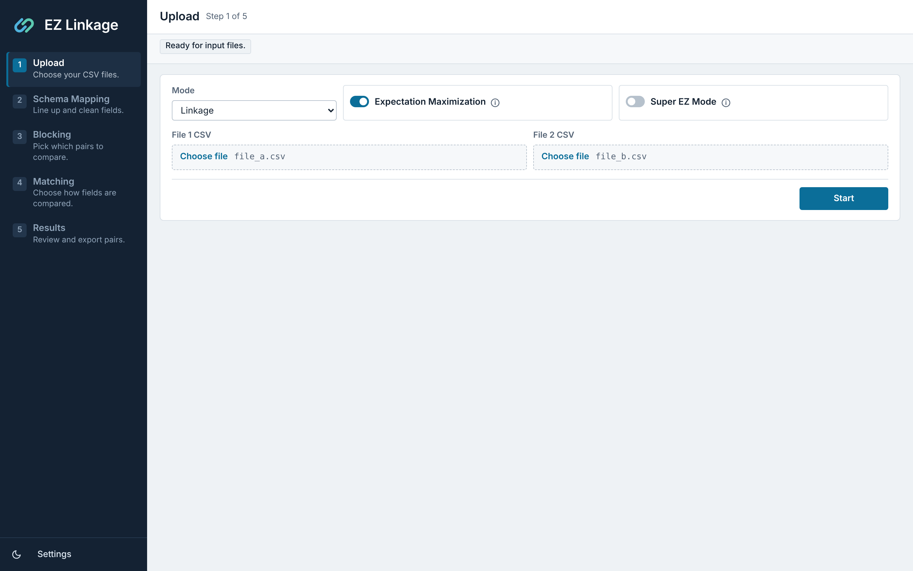
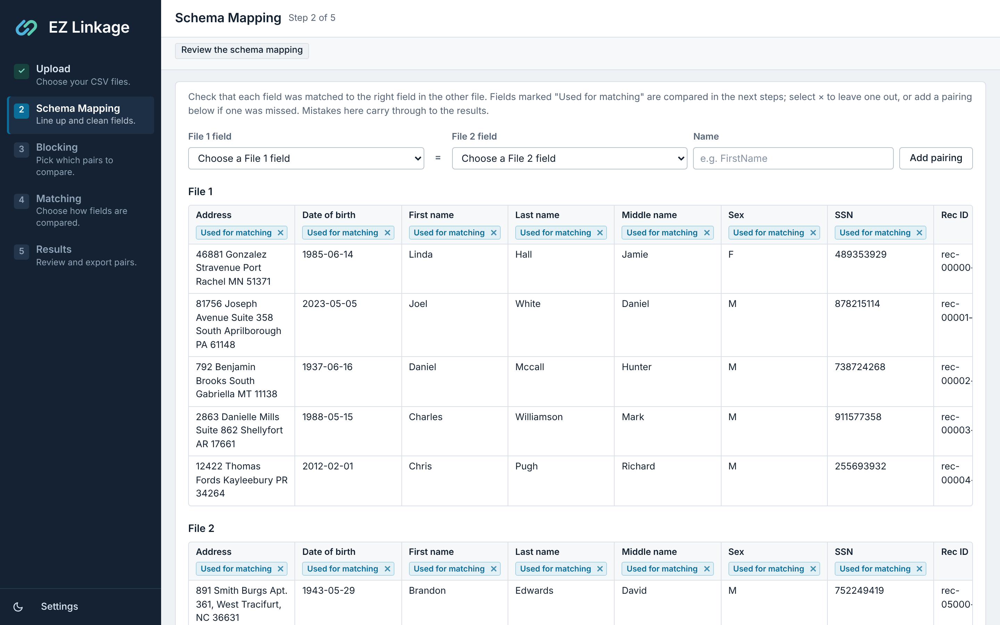
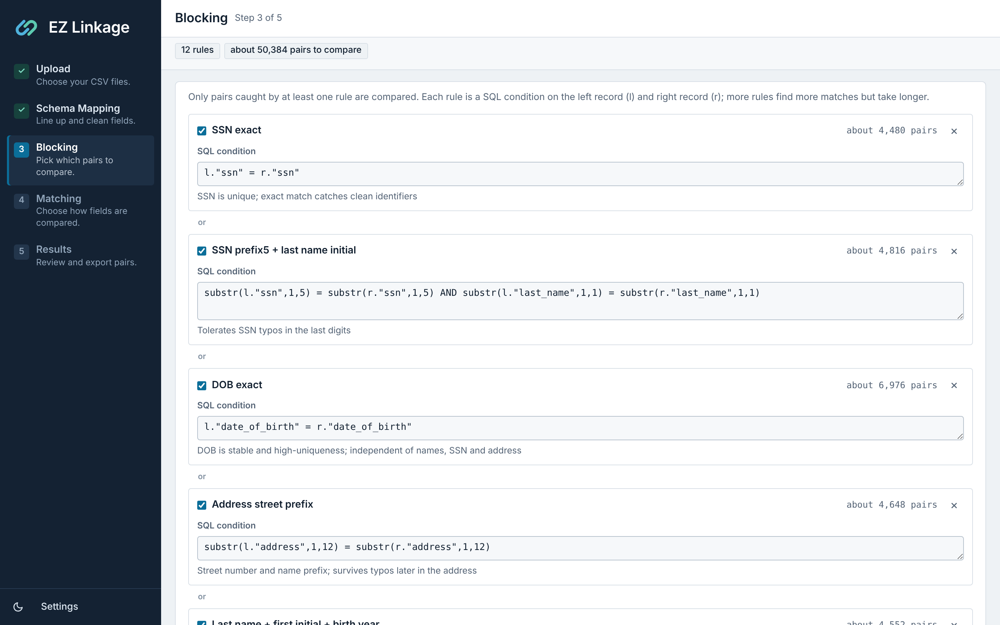
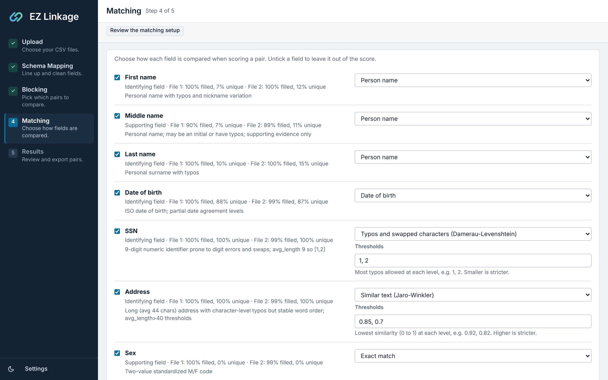
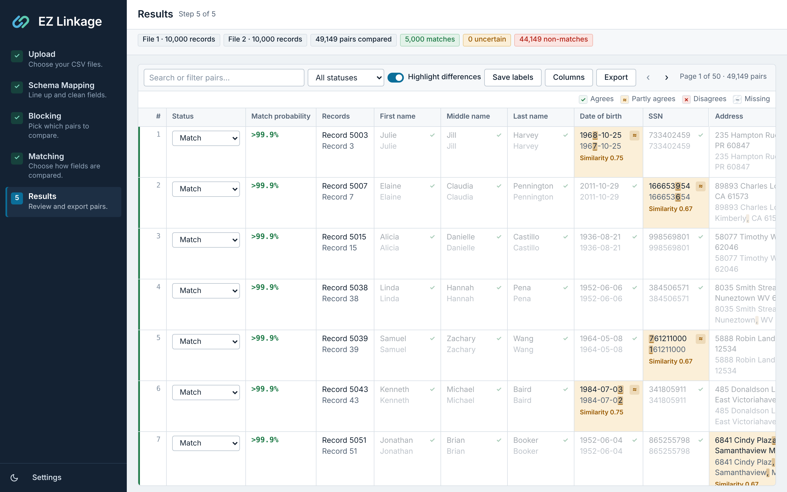
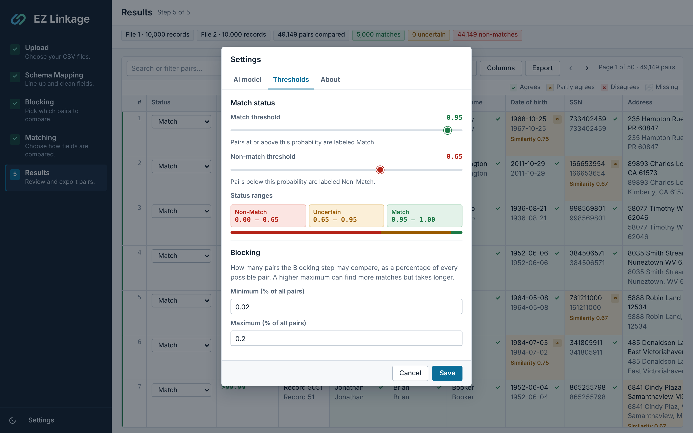
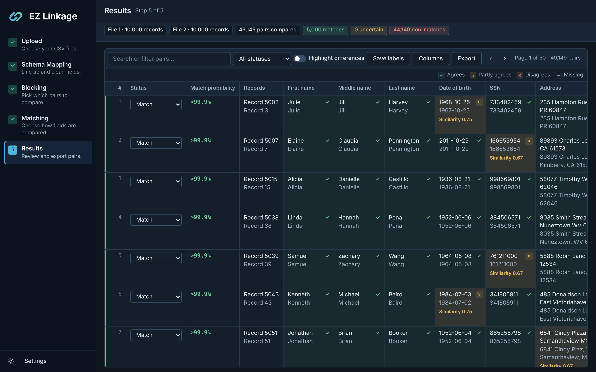

# EZ Linkage

EZ Linkage finds records that refer to the same person or entity. It can link two CSV files
(**linkage**) or find duplicates within one file (**deduplication**).

An AI model proposes how to set up each stage of the work, and you can review and change every
proposal before it is used. The record matching itself is done by
[Splink](https://github.com/moj-analytical-services/splink), an open-source probabilistic
record linkage library, running on DuckDB. The AI only plans the work; it does not decide
which records match.

The app runs on your own computer and opens in your browser at `http://127.0.0.1:5000`.



[More screenshots](#screenshots) of each step are at the end of this page.

## How it works

The work runs as five steps, shown in the sidebar.

| Step | What happens | What you review |
|---|---|---|
| **1. Upload** | Choose the mode and your CSV file or files. | Options such as Super EZ Mode and Expectation Maximization. |
| **2. Schema Mapping** | The AI lines up fields that mean the same thing in both files (for example `DOB` and `date_of_birth`) and chooses how to clean each one: trimming, case, date formats and so on. | The pairings, shown on a preview of both files. You can remove a pairing or add one the AI missed. |
| **3. Blocking** | Comparing every record with every other record is too slow on real data, so the AI writes rules that pick out the pairs worth comparing (for example "same date of birth"). Each rule is tested on a sample of your data to see how many pairs it keeps. | Each rule as an SQL condition, with the number of pairs it keeps. You can switch rules off, edit them or add your own. |
| **4. Matching** | The AI chooses how each field is compared (exact match, typo-tolerant text, dates, names and so on) and the thresholds for partial agreement. | The comparison for each field, with a summary of how complete and unique the field is. |
| **5. Results** | Splink estimates how much each field counts as evidence, scores every pair the blocking rules kept, and labels each pair Match, Uncertain or Non-Match. | Every pair side by side, with its match probability and how closely each field agrees. |

## Requirements

- Python 3.10 or newer.
- An AI model reachable through an OpenAI-compatible chat API. It can run on your own computer
  (for example [LM Studio](https://lmstudio.ai) or [Ollama](https://ollama.com)) or be a hosted service.
  Models that support tool calling work best; others can still answer in plain JSON.
- Enough memory for your data. The upload limit is 100 MB per request.

## Installation

```bash
git clone https://github.com/thebeheshti/EZ-Linkage.git
cd EZ-Linkage
python -m venv .venv          # on macOS: python3 -m venv .venv
# Windows:        .venv\Scripts\activate
# macOS / Linux:  source .venv/bin/activate
pip install -r requirements.txt
```

Creating the `.venv` folder is recommended: the launchers below use it automatically.

## Running the app

The easiest way is to double-click the launcher for your system in the EZ-Linkage folder. It
starts the app with the Python in `.venv` (or the system Python if there is no `.venv`) and opens
the app in your browser.

| System | Launcher | Notes |
|---|---|---|
| Windows | `launch.bat` | Opens a console window. Close it, or press Ctrl+C in it, to stop the app. |
| macOS | `launch.command` | Opens a Terminal window. Close it, or press Ctrl+C in it, to stop the app. |

On macOS, the first time you open `launch.command` the system may say it cannot verify the
developer. Right-click the file, choose **Open**, then **Open** again; after that a double-click works.
If it says you do not have permission, run `chmod +x launch.command` once in Terminal from the
EZ-Linkage folder.

You can also start the app from a terminal, with the `.venv` activated:

```bash
python app.py
```

Then open `http://127.0.0.1:5000` in your browser.

Two environment variables change how it starts. You can set them in your shell or in a `.env` file
next to `app.py` (see `.env.example`):

| Variable | Default | Effect |
|---|---|---|
| `LINKAGE_APP_PORT` | `5000` | The port the app listens on. |
| `LINKAGE_APP_OPEN_BROWSER` | not set | Set to `1` to open the browser automatically on startup. |

## Connecting an AI model

The app does not come set up for any particular service or model. Before the first run, open
**Settings** (bottom of the sidebar), go to the **AI model** tab, and enter:

- **Base URL**: the address of the OpenAI-compatible API, usually ending in `/v1`. For example,
  LM Studio's local server is `http://127.0.0.1:1234/v1` and Ollama's is `http://127.0.0.1:11434/v1`.
- **Model**: the model name exactly as your service lists it.
- **API key**: only needed for services that require one. Leave it blank for LM Studio or Ollama.
  Either type the key, or choose **Use a system variable** and enter the name of an environment
  variable that already holds it, such as `MY_API_KEY`. The app reads the variable each time it
  calls the model and shows whether it is set. After creating or changing a variable, restart the app.

  To create a variable on Windows, search the Start menu for "Edit environment variables for your
  account" and add it under **User variables**, or run `setx MY_API_KEY "your-key"` in a terminal.
  On macOS or Linux, add `export MY_API_KEY="your-key"` to `~/.zshrc` or `~/.bashrc`.

The same tab has optional model parameters. They start empty, which means **Model default**: the
app does not send them, and your service or model uses its own settings. Only the values you enter
are sent. Set one only if your model's documentation recommends it, because some models and services
reject parameters they do not support.

- **Temperature**, **Top-P** and **Top-K**: the usual sampling settings. Top-K is not part of the
  OpenAI API, but local servers such as LM Studio, Ollama, vLLM and llama.cpp accept it.
- **Reasoning effort**: sent exactly as you type it, because models name their levels differently.
  Common values are `none`, `minimal`, `low`, `medium`, `high` and `xhigh`; use one your model lists.
- **Extra request parameters**: a JSON object added to every request as-is, for settings specific to
  your model or service. For example, `{"min_p": 0.05}`, or
  `{"chat_template_kwargs": {"enable_thinking": false}}` to turn off thinking on some local servers.

HTTPS certificates are checked against your computer's own certificate store, the same one your
browser uses, so a service whose certificate your organization installed works without extra setup.

Larger models make better proposals, especially for schema mapping on messy files, but every
proposal can be reviewed and corrected, so a mid-sized local model is usually enough.

## Using the app

### 1. Upload

- **Mode**: *Linkage* finds the same records in two files; *Deduplication* finds repeated records in one file.
- **Files**: CSV files with a header row. The files do not need the same column names or order.
- **Expectation Maximization**: when on, Splink learns from your files how much agreement on each field
  means two records match. This is slower but usually more accurate. When off, general default
  weights are used and the Results page says so.
- **Super EZ Mode**: runs every step without stopping for review. Useful once you trust the setup
  for a kind of data, or for a quick first look.

Select **Start** to begin. While a step runs, the page says what it is doing, and **Stop** cancels it.
If a step fails, the app returns you to the Upload page with the error shown.

### 2. Schema Mapping

The preview shows a few records from each file. Columns the AI paired are marked **Used for matching**;
select × on a badge to leave that field out. To add a pairing the AI missed, choose a field from each
file, give the pair a name, and select **Add pairing**.

If the AI found something worth checking (for example a column whose values do not look like its
name, or dates in a mix of formats) it is listed at the top of the page.

Dates are converted to one format. For dates such as `05/04/2001`, the app works out from the data
whether each column is written month-first or day-first, and applies the same order to related
columns in both files.

### 3. Blocking

Each card is one rule: a name, the SQL condition (`l.` is the left record and `r.` the right record),
the reason for the rule, and about how many pairs it keeps. A pair is compared if **any** rule keeps it.

- More rules, or looser ones, find more true matches but take longer.
- Rules that keep too few pairs can miss matches that differ on the blocked field.
- Use **Add rule** to write your own, or edit a condition directly. Edited rules are marked as such.

The AI aims for a total between a minimum and a maximum share of all possible pairs, which you can
change under **Settings > Thresholds**.

Pair counts are estimates: each rule is run on a sample of each file and scaled up to the full files.

### 4. Matching

Each field has a comparison method, chosen from its values: for example *Person name*,
*Date of birth*, *Typos and swapped characters* (Damerau-Levenshtein) for ID numbers, *Similar text*
(Jaro-Winkler) for addresses, or *Exact match*. For methods with levels of partial agreement, the
thresholds are listed and can be edited. Untick a field to leave it out of the score.

### 5. Results

The table shows one row per compared pair, with each field's two values one above the other (File 1
on top). A coloured strip at the left of each row shows its status. The **Records** column gives each
record's number in its file, counting from 1 for the first record after the header row.

Each compared field is tinted, with a symbol, by how its two values agree:

| Mark | Meaning |
|---|---|
| ✓ light green | Agrees (the highest comparison level for that field) |
| ≈ amber | Partly agrees; the similarity is shown, from 0 to 1 |
| ✗ red | Disagrees |
| – grey stripes | Missing in one file, so it gives no evidence either way |

Fields added with **Columns** were not compared by the model and are shown without a mark.

- **Highlight differences**: marks the characters that differ between the two values, so typos,
  swapped digits and abbreviations stand out, and fades the fields that agree.
- **Status**: change a pair's label from its dropdown. Labels are saved when you select
  **Save labels**, change page, or change the search or filter.
- **Search and filter**: search any value, or show one status at a time.
- **Columns**: add other fields from your files to the table.
- **Thresholds**: change them in **Settings > Thresholds** and every pair is relabeled without
  running the linkage again.
- **Export**: download File 1 or File 2 with a status column added, or one row per pair with both
  records side by side, filtered to the statuses you choose. Exports include each record's number
  in its file.

A pair is labeled **Match** if its probability is at or above the match threshold, **Non-Match**
if it is below the non-match threshold, and **Uncertain** in between. Uncertain pairs are the ones
worth checking by hand.

## Settings

Settings are saved in `settings.json` next to the app, except the API key (see below).

| Setting | Default | Meaning |
|---|---|---|
| Base URL | None, required | OpenAI-compatible API address. |
| Model | None, required | Model name sent to the API. |
| Temperature, Top-P, Top-K | Model default | Sampling parameters, sent only when set. |
| Reasoning effort | Model default | Sent as typed, only when set. |
| Extra request parameters | None | JSON added to every request, for model-specific settings. |
| Match threshold | 0.95 | Pairs at or above this probability are labeled Match. |
| Non-match threshold | 0.65 | Pairs below this probability are labeled Non-Match. |
| Blocking minimum / maximum | 0.02% / 0.2% of all pairs | The range the Blocking step aims for. |

## Files the app creates

All of these are created next to `app.py`, and all
are excluded from git.

| Path | Contents |
|---|---|
| `settings.json` | Your settings, and the remote AI services you have approved. |
| `.env` | The API key, if you typed one in Settings. |
| `outputs/` | `linkage_results_<job>.csv` for each run, updated when you save labels. |
| `ai_logs/` | Every request sent to the AI and its reply, as JSON. |
| `app_logs/` | The app's own log. |

Closing the app clears results from memory, but the CSV files in `outputs/` remain.

## Privacy and security

- **What is sent to the AI.** A few sample records from each file (6 to 8) and per-field summaries
  such as how often a field is filled and how many values are unique. Sample records can include names,
  dates of birth and ID numbers. Full files are never sent. Everything sent is also written to
  `ai_logs/`.
- **Remote services need your approval.** Before the first request to an AI service that is not on
  this computer or your private network, the app asks you to approve that address. The approval is
  remembered in `settings.json`. For sensitive data, use a model running on your own computer.
- **The API key stays on your computer.** It is written to `.env` (readable only by your user account
  where the system supports it), or read from the system variable you name, and is never stored in
  or sent to the browser.
- **The app is only reachable from your computer.** It listens on `127.0.0.1` and rejects requests
  from other websites or other hostnames.
- **AI-written cleaning code runs on your computer.** When no built-in cleaning step fits a field, the
  AI can write a small Python function for it. These functions are checked before use and limited in
  what they can call and how long they can run, but this is a safeguard rather than full isolation.
  Review the Schema Mapping step when working with untrusted AI services.

## Technical overview

| File | Role |
|---|---|
| `app.py` | Flask server: pages, API endpoints, background jobs, request checks. |
| `core.py` | Runs Splink: model setup, training, scoring, labeling and CSV export. |
| `schema_agent.py` | Schema Mapping agent: field pairing, cleaning plans, date-order detection. |
| `blocking_agent.py` | Blocking agent: writes rules and measures them on a sample. |
| `matching_agent.py` | Matching agent: chooses a comparison and thresholds for each field. |
| `agent_runtime.py` | Shared agent loop: tool calls, retries, cancellation, logging. |
| `comparators.py` | Builds Splink comparisons from the Matching plan. |
| `linkage_inputs.py` | Turns cleaned data into the records Splink compares. |
| `llm_client.py` | Connection settings for the AI service. |
| `api_key_store.py` | Reads the API key from `.env` or from the system variable chosen in Settings. |
| `app_paths.py` | Where the app reads assets and writes its files. |
| `templates/`, `static/` | The interface: one HTML page, its script and stylesheet. |

Each agent is a LangChain agent with a small set of tools for looking at the data. It must submit
its plan through a tool that checks the plan before accepting it; a rejected plan goes back to the
agent with the reason. Splink uses the Fellegi-Sunter model: each field adds evidence for or against
a match, weighted by how informative agreement on that field is, and the total becomes a match
probability.

The app uses Splink 5 with DuckDB, and does not need pandas. Splink 4 is not supported: if an older
Splink is installed, the app stops at startup and shows the command that installs the right version.

## Evaluation data

The synthetic datasets used to evaluate EZ Linkage are in [`evaluation_data/`](evaluation_data):
two files of 10,000 fictional people each, in different layouts and with realistic data-entry
errors in the second, the list of 5,000 true matches, and the script that generated them. See
[`evaluation_data/README.md`](evaluation_data/README.md) for how the data is built.

## References

- Linacre R, Lindsay A, Manassis T, et al. (2023). *Splink: Free software for probabilistic record
  linkage at scale.* International Journal of Population Data Science.
- Fellegi I P, Sunter A B (1969). *A Theory for Record Linkage.* Journal of the American Statistical
  Association, 64(328), 1183-1210.

## Screenshots

The screenshots come from a run on the [evaluation datasets](evaluation_data), which are synthetic: none of the people are real.

**1. Upload.** Choose the mode and your files, and whether Splink should learn match weights from your data (Expectation Maximization).



**2. Schema Mapping.** The fields the AI lined up across the two files, marked "Used for matching", on a preview of each file.



**3. Blocking.** Each rule is an SQL condition with the number of pairs it keeps, which you can edit, switch off or add to.



**4. Matching.** How each field is compared, with a summary of how complete and unique it is in each file.



**5. Results with "Highlight differences".** The characters that differ between two values are marked, and the fields that agree fade out.



**6. Settings**



**7. Dark Mode**



## License

MIT. See [LICENSE](LICENSE).
